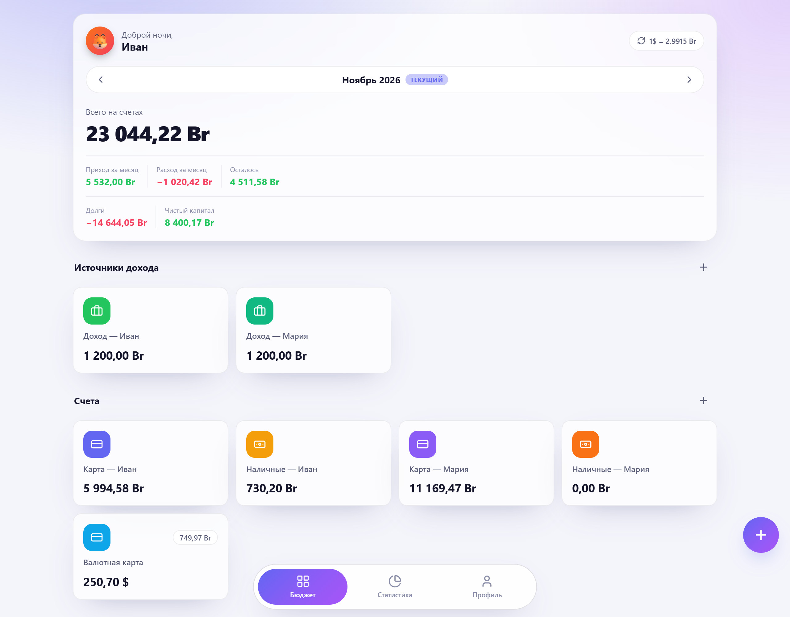

<div align="center">


# Budget+ · a shared budget for two

A lightweight self-hosted web app for couples to track money together.
Accounts, spending, debts and savings in one place, with NBRB exchange rates and a dark theme.

[](https://github.com/KROWIEL/family-budget-plus/releases)
[](https://github.com/KROWIEL/family-budget-plus/actions/workflows/ci.yml)
[](LICENSE)

**[Website](https://krowiel.github.io/family-budget-plus/)** · **[Русский](README.md)**



</div>

> The interface is in Russian. Currencies are Belarusian rubles (BYN) and US dollars,
> converted with the official rate of the National Bank of the Republic of Belarus (NBRB).

## Features

- **Accounts and transactions:** income sources, cards, cash and savings jars with goals;
  income, expenses, transfers and debt payments. Balances are derived from transactions.
- **Real conversion amounts:** banks rarely convert at the official rate, so for cross-currency
  transfers and payments you can type the amount actually received; the real rate is stored.
- **Categories with monthly limits** (BYN or USD), progress bars and per-category history.
- **Debts, loans and leasing:** remaining balance, monthly payment, due day, archive, net worth.
- **Statistics** for 1 / 3 / 6 / 12 months ending with the current month: donut chart,
  comparison with the previous period, per-person breakdown, savings dynamics.
  Spending is converted at the rate **on the transaction date**.
- **Backup and restore** of the SQLite database from the UI, including files from older schema versions.
- Light and dark themes, avatars, mobile-friendly layout.

## Quick start

```bash
git clone https://github.com/KROWIEL/family-budget-plus.git
cd family-budget-plus
cp .env.example .env        # set usernames and passwords for both users
docker compose -f docker-compose.local.yml up -d --build
```

Open **http://localhost:8080**.

## Production with a domain and HTTPS

Point your domain's A record to the server, open ports 80 and 443, set `DOMAIN`,
`ACME_EMAIL` and `COOKIE_SECURE=true` in `.env`, then run:

```bash
docker compose up -d --build
```

Caddy obtains and renews a Let's Encrypt certificate automatically. Data lives in `./data`.

## Stack

FastAPI with the standard `sqlite3` module (no ORM), Svelte 4 + Vite, plain SVG charts,
Lucide icons, Caddy. Passwords are hashed with `scrypt`; login attempts are rate-limited.

## License

[MIT](LICENSE) — free to use, copy, modify and distribute, including commercially.
