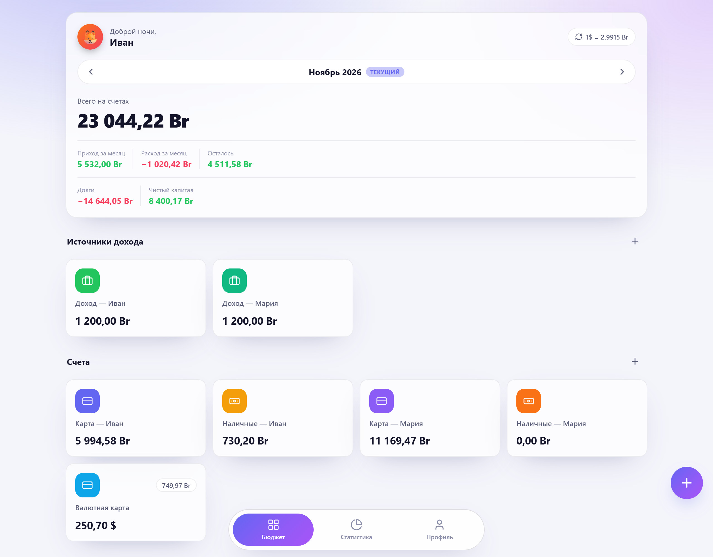
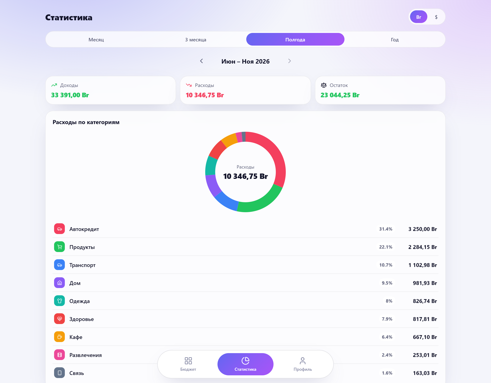
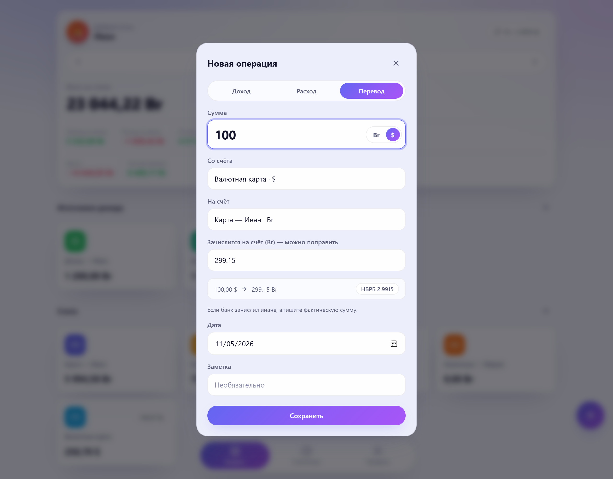
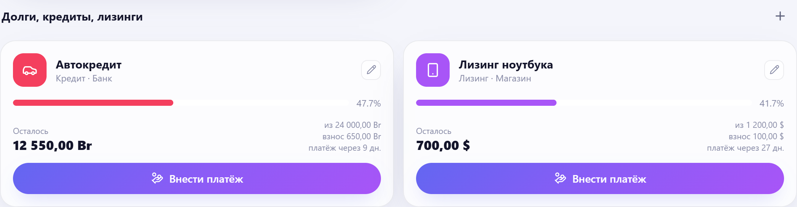
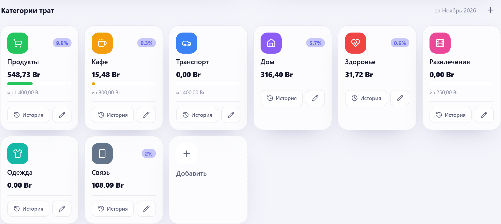
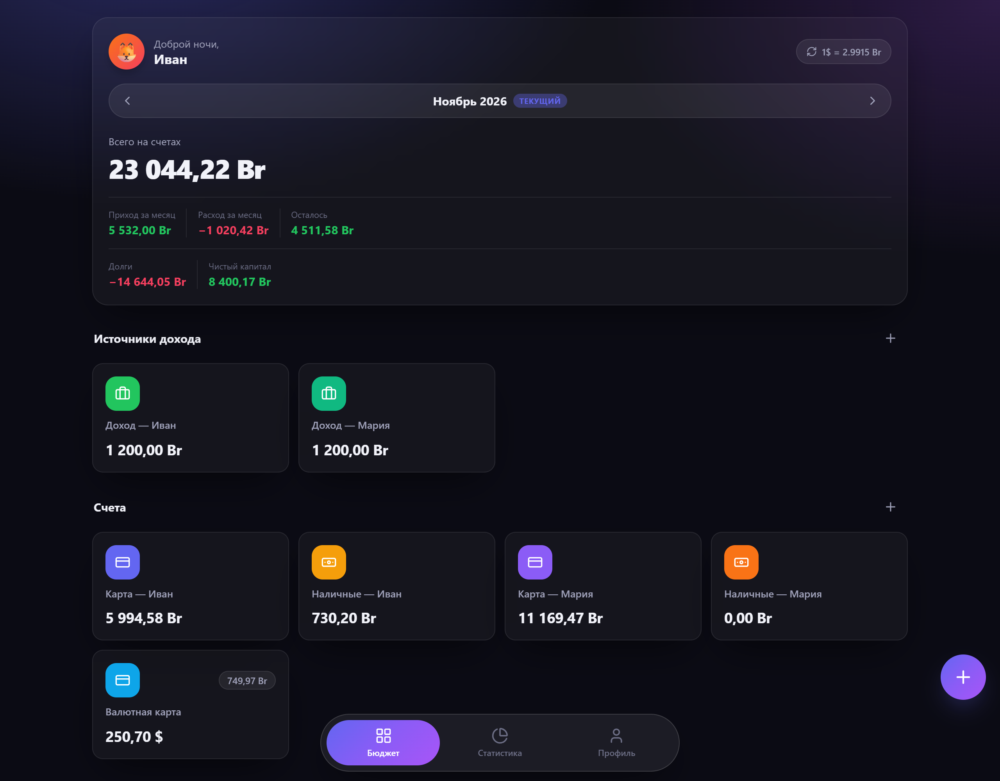
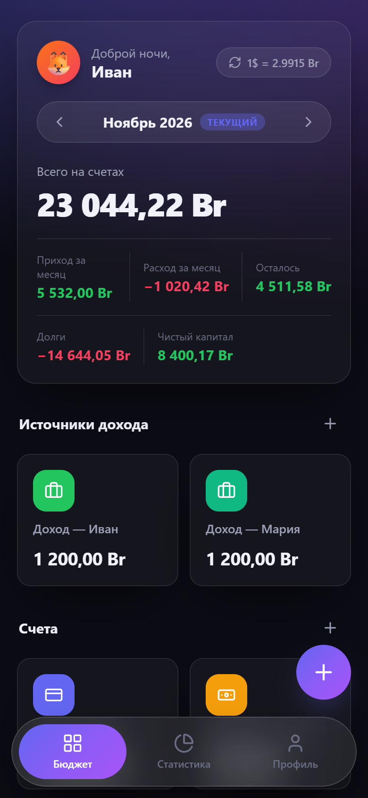
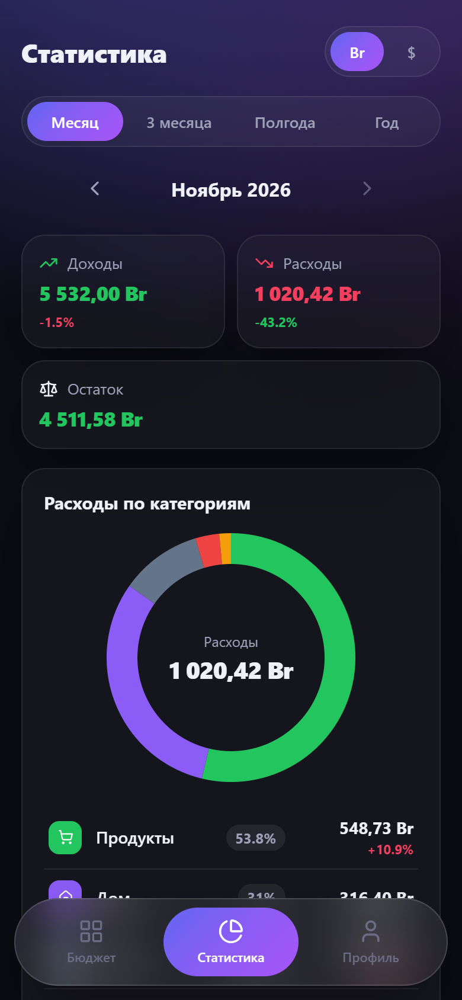

<div align="center">


# Budget+ · семейный бюджет на двоих

Лёгкое self-hosted веб-приложение для совместного учёта денег в паре.
Счета, траты, долги и копилки — в одном месте, с курсом НБРБ и тёмной темой.

[](https://github.com/KROWIEL/family-budget-plus/releases)
[](https://github.com/KROWIEL/family-budget-plus/actions/workflows/ci.yml)
[](LICENSE)


**[Сайт проекта](https://krowiel.github.io/family-budget-plus/)** ·
**[Быстрый старт](#быстрый-старт)** ·
**[English](README.en.md)**



</div>

## Зачем

Большинство приложений для бюджета либо рассчитаны на одного человека, либо хранят
ваши финансы в чужом облаке. Budget+ — это один Docker-контейнер на вашем сервере,
два аккаунта (вы и партнёр) и общая картина: сколько пришло, куда ушло, сколько
осталось и сколько ещё должны банку.

## Возможности

**Счета и операции**
- Источники дохода, карты, наличные и копилки с целью накопления — у каждого участника свои.
- Доходы, расходы, переводы между счетами и платежи по долгам. Баланс счёта считается из операций.
- Мультивалютность BYN / USD: сумму можно вводить в любой валюте, приложение пересчитает по курсу НБРБ.
- **Фактическая сумма конвертации.** Банк редко меняет по курсу НБРБ, поэтому при переводе или
  платеже между валютами сумму зачисления можно поправить руками — сохранится реальный курс операции.
- Поиск по операциям месяца и постраничный список.

**Категории и лимиты**
- Категории трат с иконками и цветами, месячный лимит в BYN или USD с прогресс-баром.
- История трат по каждой категории.

**Долги, кредиты, лизинги**
- Полная сумма, остаток, ежемесячный платёж, день платежа и подсказка «платёж через N дней».
- Платёж списывается с выбранного счёта, уменьшает долг и попадает в статистику.
- Выплаченные долги уходят в архив. Блок «Чистый капитал» — счета минус долги.

**Статистика**
- Окна «месяц / 3 месяца / полгода / год», всегда заканчиваются текущим месяцем — без будущих периодов.
- Кольцевая диаграмма расходов по категориям, сравнение с прошлым периодом, разбивка по участникам.
- Динамика накоплений в копилках. Траты пересчитываются по курсу **на дату операции**, а не по сегодняшнему.

**Остальное**
- Светлая и тёмная тема, аватарки, валюта отчётов для каждого пользователя.
- Резервная копия базы одной кнопкой и восстановление из файла — в том числе из старой версии схемы.
- Работает на телефоне: адаптивная вёрстка и нижняя навигация.

## Скриншоты

| Статистика за полгода | Перевод с ручной суммой |
| :---: | :---: |
|  |  |

| Долги и кредиты | Категории с лимитами |
| :---: | :---: |
|  |  |

| Тёмная тема | Телефон |
| :---: | :---: |
|  |   |

## Быстрый старт

Нужен Docker с плагином Compose.

```bash
git clone https://github.com/KROWIEL/family-budget-plus.git
cd family-budget-plus
cp .env.example .env        # задайте логины и пароли двух пользователей
docker compose -f docker-compose.local.yml up -d --build
```

Откройте **http://localhost:8080** и войдите под пользователем из `.env`.

## Установка на сервер с доменом и HTTPS

В комплекте есть [Caddy](https://caddyserver.com/): он сам получит и будет продлевать
сертификат Let's Encrypt.

1. Направьте A-запись домена (например, `budget.example.com`) на IP сервера.
   Порты **80** и **443** должны быть открыты.
2. Заполните `.env`:

   ```bash
   cp .env.example .env
   nano .env
   ```

   | Переменная | Что указать |
   | --- | --- |
   | `DOMAIN` | ваш домен без `https://` |
   | `ACME_EMAIL` | email для Let's Encrypt |
   | `COOKIE_SECURE` | `true` — сайт работает только по HTTPS |
   | `SEED_USER1_*`, `SEED_USER2_*` | логин, имя, пароль и аватар каждого участника |

3. Запустите:

   ```bash
   docker compose up -d --build
   ```

Приложение откроется на **https://ваш-домен**. Порт 8080 наружу не публикуется — весь
трафик идёт через Caddy. База SQLite лежит в `./data` на хосте, сертификаты — в томе
`caddy_data`; обе вещи переживают пересборку.

Обновление: `git pull && docker compose up -d --build`.

## Конфигурация

| Переменная | По умолчанию | Назначение |
| --- | --- | --- |
| `SEED_USER{1,2}_USERNAME` | — | логин (без него пользователь не создаётся) |
| `SEED_USER{1,2}_PASSWORD` | — | пароль при первом запуске |
| `SEED_USER{1,2}_NAME` | логин | отображаемое имя |
| `SEED_USER{1,2}_AVATAR` | `fox` | `fox`, `cat`, `dog`, `owl`, `bear`, `panda`, `penguin`, `koala` и другие |
| `SEED_DEFAULT_ACCOUNTS` | `true` | создать стартовый набор счетов |
| `NBRB_AUTO_REFRESH` | `true` | обновлять курс НБРБ раз в день |
| `COOKIE_SECURE` | `false` | Secure-cookie; включите за HTTPS |
| `SESSION_DAYS` | `30` | сколько дней живёт сессия |
| `DOMAIN`, `ACME_EMAIL` | — | только для Caddy |

Пользователи создаются один раз, при первом запуске с пустой базой. Дальше пароль,
имя и аватар меняются в приложении, в разделе «Профиль».

## Резервные копии

В «Профиле» есть кнопка **«Скачать backup»** — это консистентная копия SQLite-базы.
**«Восстановить из файла»** загружает копию обратно: схема старого файла
автоматически дополняется недостающими полями, пользователи и сессии сохраняются,
а текущая база перед заменой копируется в `data/budget-before-restore.db`.

## Разработка

```bash
# Backend (Python 3.12+)
cd backend
pip install -r requirements.txt
DATA_DIR=./data SEED_USER1_USERNAME=ivan SEED_USER1_PASSWORD=dev \
  uvicorn app.main:app --reload --port 8080

# Frontend — dev-сервер с прокси /api на :8080
cd frontend
npm install
npm run dev
```

Проверки бэкенда — обычные скрипты на `assert`:

```bash
cd backend
DATA_DIR=/tmp/bp python test_security.py
DATA_DIR=/tmp/bp python test_cross_sides.py
```

Документация API (Swagger) доступна по адресу `/docs` запущенного приложения.

### Как устроено

```
backend/      FastAPI + стандартный sqlite3, без ORM
  app/routers/  accounts, categories, debts, transactions, stats, profile, rates, auth
  app/nbrb.py   курс НБРБ с кэшем на день и курсом на дату
frontend/     Svelte 4 + Vite, диаграммы на чистом SVG, иконки Lucide
caddy/        конфиг обратного прокси с автоматическим HTTPS
Dockerfile    сборка фронтенда и рантайм в одном образе
```

Суммы хранятся в валюте счёта. Для каждой операции сохраняется курс НБРБ на её дату и
фактический курс конвертации, поэтому статистика прошлых месяцев не «плывёт» вместе с курсом.

## Безопасность

- Пароли хешируются через `scrypt` с солью. Старые md5-хеши из ранних версий
  автоматически заменяются при следующем входе.
- Сессии — случайные токены в базе, cookie `HttpOnly` + `SameSite=Lax`.
- После 10 неудачных входов с одного IP вход блокируется на 15 минут.
- Регистрации нет: войти могут только два пользователя из `.env`.

Нашли уязвимость — напишите, пожалуйста, через
[приватное сообщение об уязвимости](https://github.com/KROWIEL/family-budget-plus/security/advisories/new),
а не в публичный issue.

## Лицензия

[MIT](LICENSE) — используйте, копируйте, меняйте и распространяйте свободно, в том
числе в коммерческих проектах. Достаточно сохранить текст лицензии.
